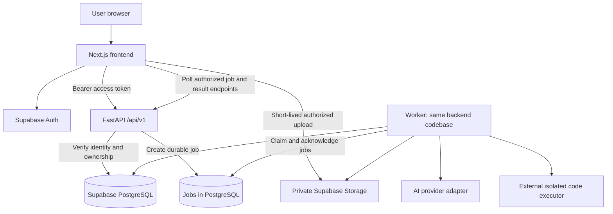

# Mockmate architecture and two-person build plan

> The two-person ownership split is superseded by [the current build-with-Codex architecture](mockmate-solo-build-architecture.md). Keep this document as a detailed technical reference; use the newer document for phase scope and execution ownership.

Proposed target architecture · 8 November 2026

This is a handoff specification, not a description of code already implemented. The existing Next.js frontend stays in place. Most backend, database, and infrastructure paths below are proposed additions. Create them as their milestone starts, rather than committing empty folders.

## 1. Product and ownership

Build four primary areas: Resume Analysis, Interview Practice, Coding Rounds, and Suggestions & Advice. Dashboard, analytics, account settings, and plan access support these areas.

- **A — you:** frontend, UX, browser integration, frontend tests.
- **B — your friend:** FastAPI, database, AI, worker, execution integration, backend tests.
- **S — shared:** API contracts, requirements, integration acceptance, deployment decisions, PR review.

These are suggested roles and can be swapped. B's scope is larger than A's because the frontend already exists. After A connects the existing screens, A should take browser voice integration, deployment documentation, and full-flow QA while B finishes backend services. Shared ownership means agree and review together; assign one author to each shared file in an issue.

First real release: accounts, private resume upload/analysis, text interviews with persisted evaluations, history, and suggestions. Coding execution follows that foundation. Voice is a later milestone. Existing video UI remains a local preview until a separate video requirement is agreed. Job Matching, course-based Learning Hub, and automated face/presence proctoring remain outside this release.

## 2. Runtime architecture



One repository, one Next.js app, one modular Python backend. API and worker run as separate processes from the same backend image. AI orchestration lives inside the backend, rather than in a separately deployed `ai-engine/`. Database and private storage use Supabase. A code executor is a distinct trust boundary: user code must never run inside the API or worker process.

The frontend calls FastAPI directly for business operations. Next.js handles rendering and Supabase auth/session integration; it does not duplicate business APIs. Browser calls send the user's access token. Server-rendered access, if later needed, forwards the same user identity through the API client. CORS accepts configured frontend origins only.

## 3. Complete target project tree

Legend: `[A]` frontend owner, `[B]` backend owner, `[S]` coordinated contract or integration work. Ownership on a directory applies to its descendants unless overridden. `[later]` is a deferred milestone, not a requirement to implement immediately.

```text
Mockmate/
|
|-- README.md                              [S] Setup, product scope, links
|-- LICENSE                                [S] Agree the license before adding
|-- .gitignore                             [S]
|-- .editorconfig                          [S]
|-- .env.example                           [A] Public frontend config only
|-- package.json                           [A] Existing Next.js app/scripts
|-- package-lock.json                      [A]
|-- next.config.ts                         [A]
|-- next-env.d.ts                          [A] Framework-managed
|-- tsconfig.json                          [A]
|-- eslint.config.mjs                       [A]
|-- postcss.config.mjs                      [A]
|-- components.json                        [A]
|-- playwright.config.ts                   [A]
|-- compose.yaml                           [B] Local API + worker; DB via Supabase
|
|-- public/                                [A] Static assets as needed
|   |-- images/
|   `-- icons/
|
|-- src/                                   [A] Existing frontend stays here
|   |-- app/
|   |   |-- (public)/
|   |   |   |-- page.tsx                    Home
|   |   |   |-- about/page.tsx
|   |   |   |-- pricing/page.tsx
|   |   |   |-- login/page.tsx
|   |   |   |-- register/page.tsx
|   |   |   `-- forgot-password/page.tsx
|   |   |-- auth/
|   |   |   |-- callback/route.ts           Auth callback, not business API
|   |   |   `-- reset-password/page.tsx
|   |   |-- (workspace)/dashboard/
|   |   |   |-- layout.tsx                  Authenticated workspace shell
|   |   |   |-- loading.tsx
|   |   |   |-- page.tsx
|   |   |   |-- resume/
|   |   |   |   |-- page.tsx
|   |   |   |   |-- analyze/page.tsx
|   |   |   |   `-- improve/page.tsx
|   |   |   |-- interview/
|   |   |   |   |-- page.tsx
|   |   |   |   |-- setup/page.tsx
|   |   |   |   `-- [interviewId]/report/page.tsx
|   |   |   |-- coding/page.tsx
|   |   |   |-- analytics/page.tsx
|   |   |   |-- suggestions/page.tsx
|   |   |   `-- settings/page.tsx
|   |   |-- interview-room/[interviewId]/page.tsx
|   |   |-- layout.tsx
|   |   |-- globals.css
|   |   |-- error.tsx
|   |   |-- not-found.tsx
|   |   `-- icon.svg
|   |-- proxy.ts                           Session refresh/early navigation checks
|   |-- components/
|   |   |-- ui/                            Existing owned UI primitives
|   |   |-- app-shell.tsx
|   |   |-- marketing-shell.tsx
|   |   |-- sidebar.tsx
|   |   |-- brand.tsx
|   |   |-- charts.tsx                      Takes result data through props
|   |   |-- providers.tsx
|   |   |-- theme-toggle.tsx
|   |   `-- plan-access.tsx                 Displays server entitlements
|   |-- features/
|   |   |-- auth/
|   |   |-- marketing/
|   |   |-- dashboard/
|   |   |-- resume/
|   |   |-- interview/
|   |   |-- coding/
|   |   |-- suggestions/
|   |   |-- settings/
|   |   `-- voice/                         [later] Capture/playback/transcript UI
|   |-- services/
|   |   |-- api-client.ts                  Token, timeout, errors, cancellation
|   |   |-- profile-service.ts
|   |   |-- resume-service.ts
|   |   |-- interview-service.ts
|   |   |-- coding-service.ts
|   |   |-- suggestions-service.ts
|   |   |-- analytics-service.ts
|   |   |-- entitlement-service.ts
|   |   |-- job-service.ts                 Polling, retry UI, terminal states
|   |   `-- voice-service.ts               [later]
|   |-- lib/
|   |   |-- supabase/{browser,server}.ts    Auth/session clients
|   |   |-- api/generated.ts               Generated; never edit manually [S]
|   |   |-- validation.ts                  Form/view validation
|   |   `-- utils.ts
|   |-- hooks/                             Devices, jobs, drafts, feature access
|   |-- stores/
|   |   |-- ui-store.ts                     UI-only preferences/state
|   |   `-- draft-store.ts                  User-scoped unsent drafts
|   |-- types/                             View models; API DTOs are generated
|   |-- constants/navigation.ts
|   |-- config/
|   |   |-- environment.ts
|   |   |-- plans.ts                        Presentation; server owns limits
|   |   `-- coding.ts                       Presentation; server owns timer/rules
|   `-- demo/                              Explicit demo adapter and fixtures
|       |-- data/
|       |-- services/
|       `-- demo-store.ts
|
|-- backend/                               [B]
|   |-- pyproject.toml                     Python dependencies and tooling
|   |-- uv.lock                            Reproducible Python dependency lock
|   |-- .env.example                       Server-only variable names
|   |-- Dockerfile                         Shared API/worker image
|   |-- app/
|   |   |-- __init__.py
|   |   |-- main.py                        FastAPI app, CORS, router, lifecycle
|   |   |-- core/
|   |   |   |-- config.py
|   |   |   |-- auth.py                     JWT verification/current user
|   |   |   |-- database.py                 Connections/transactions
|   |   |   |-- errors.py                   Consistent public error responses
|   |   |   |-- logging.py                  Request/job IDs, redaction
|   |   |   `-- rate_limits.py
|   |   |-- api/
|   |   |   |-- dependencies.py             Identity, DB, service dependencies
|   |   |   `-- v1/
|   |   |       |-- router.py
|   |   |       |-- health.py
|   |   |       |-- profiles.py
|   |   |       |-- resumes.py
|   |   |       |-- interviews.py
|   |   |       |-- coding.py
|   |   |       |-- suggestions.py
|   |   |       |-- analytics.py
|   |   |       |-- entitlements.py
|   |   |       |-- jobs.py
|   |   |       |-- voice.py                [later]
|   |   |       `-- billing.py              [later] Checkout + verified webhooks
|   |   |-- modules/                        Domain behavior, not HTTP handlers
|   |   |   |-- profiles/
|   |   |   |-- resumes/
|   |   |   |-- interviews/
|   |   |   |-- coding/
|   |   |   |-- suggestions/
|   |   |   |-- analytics/
|   |   |   |-- entitlements/
|   |   |   |-- voice/                      [later]
|   |   |   `-- billing/                    [later]
|   |   |       # Each domain follows the same pattern as resumes:
|   |   |       # __init__.py, schemas.py, service.py, repository.py
|   |   |-- ai/
|   |   |   |-- schemas.py                  Validated structured AI outputs
|   |   |   |-- resume_analysis.py
|   |   |   |-- question_generation.py
|   |   |   |-- answer_evaluation.py
|   |   |   |-- coding_feedback.py
|   |   |   |-- rubrics/
|   |   |   `-- prompts/                    Versioned prompt templates
|   |   |-- integrations/
|   |   |   |-- llm.py                      AI provider adapter
|   |   |   |-- storage.py                  Private objects/signed uploads
|   |   |   |-- pdf.py                      PDF extraction and validation
|   |   |   |-- executor.py                 Isolated execution adapter [later]
|   |   |   |-- speech.py                   STT/TTS adapter [later]
|   |   |   `-- payments.py                 Payment provider adapter [later]
|   |   `-- workers/
|   |       |-- main.py                     Poll/claim jobs, shutdown/recovery
|   |       |-- queue.py                    Durable claim/lease/ack/retry
|   |       `-- tasks/
|   |           |-- analyze_resume.py
|   |           |-- generate_interview.py
|   |           |-- evaluate_interview.py
|   |           `-- execute_submission.py  [later]
|   `-- tests/
|       |-- unit/
|       |-- integration/                    API + database + ownership tests
|       |-- ai_evals/                       Fixed examples and rubric checks
|       `-- fixtures/                       Sanitized documents/provider results
|
|-- supabase/                              [B] ONLY database migration authority
|   |-- config.toml
|   |-- migrations/                        Schema, indexes, policies, functions
|   |-- seed.sql                           Synthetic local/test data
|   `-- tests/                             RLS, ownership, storage policy tests
|
|-- contracts/                             [S]
|   |-- openapi.json                       Exported from FastAPI/Pydantic
|   `-- examples/                          Agreed valid requests/results/errors
|
|-- tests/                                 [A] Frontend checks
|   |-- e2e/                               Real API-backed journeys
|   |-- demo/                              Retained simulation workflows
|   `-- fixtures/                          Synthetic browser test inputs
|
|-- scripts/                               [S] Assign one owner per script
|   |-- export-openapi.py                  [B]
|   |-- generate-api-types.mjs             [A]
|   `-- check-contracts.mjs                [S] Detect generated artifact drift
|
|-- docs/                                  [S]
|   |-- mockmate-architecture-and-team-plan.md
|   |-- architecture/
|   |   |-- system.md
|   |   |-- data-model.md
|   |   `-- decisions.md                   Short architecture decision records
|   |-- api/
|   |   |-- conventions.md
|   |   `-- integration-checklist.md
|   |-- planning/
|   |   |-- milestones.md
|   |   `-- ownership.md
|   |-- setup/
|   |   |-- local-development.md
|   |   |-- environment-variables.md
|   |   `-- deployment.md
|   |-- design-reference/                 Existing references preserved
|   `-- screenshots/                      Existing QA evidence preserved
|
|-- infrastructure/                        [B] Hosting selected at deployment
|   `-- deployment/
|       |-- frontend.md                    Build/start/env/domain settings [A]
|       |-- api.md                         Container, health, DB connections
|       `-- worker.md                      Command, concurrency, retries
|
`-- .github/                               [S]
    |-- CODEOWNERS                         Real GitHub handles before enabling
    |-- pull_request_template.md
    `-- workflows/
        |-- frontend-ci.yml                [A]
        |-- backend-ci.yml                 [B]
        |-- database-ci.yml                [B]
        `-- integration-ci.yml             [S]
```

Python package directories include `__init__.py` where appropriate; the tree abbreviates repeated package markers. Hosting files are documentation until a host is chosen; this design does not assume a paid provider or create deployments.

## 4. Module boundaries and sources of truth

HTTP router -> identity/authorization dependencies -> domain service -> repository or integration adapter. Route handlers validate input and map responses; they do not contain prompts or SQL. Services enforce transitions, ownership, quotas, and transactions. Repositories execute database operations. AI modules accept typed inputs and return validated outputs.

- **API schema:** Python Pydantic DTOs produce `contracts/openapi.json`; generate TypeScript DTOs into `src/lib/api/generated.ts`. B authors schema changes; A reviews compatibility. CI regenerates and rejects drift. Never hand-maintain equivalent API interfaces in two languages.
- **Database:** `supabase/migrations/` is the only migration history. Do not add parallel `database/migrations/` or Alembic migrations. Backend queries/models follow that schema.
- **Identity:** Supabase Auth owns accounts and credentials. FastAPI verifies token signature, issuer, audience and expiry using the configured project signing keys. Never trust a browser-supplied `user_id`.
- **Authorization:** API queries are scoped to the verified user. Enable RLS on exposed tables and Storage policies for owned objects. A direct backend database connection does not automatically inherit the browser's RLS identity: use a deliberate scoped role/context or explicit ownership predicates, and test the actual connection mode. Privileged operations must be isolated and audited.
- **Plans and quotas:** server-owned entitlement records and transactional usage reservations. The frontend only displays capabilities returned by the API. Do not trust the demo plan toggle, user-editable metadata, or browser session counts.
- **Application data:** database records are authoritative. Zustand handles UI state and optional unsent drafts, with user-scoped keys and cleanup on logout/account changes. Real reports and history must survive a different browser or device.
- **Demo:** demo fixtures and adapters remain explicitly selected and clearly labelled. They must never be a silent fallback for failed production API calls or automatically imported into a real user's account.
- **Timers:** the backend returns `started_at` and `expires_at` and enforces deadlines; browser timers are a display. Submitted content and reports become immutable snapshots or versioned revisions.

## 5. Minimum data model

Use UUID identifiers and UTC timestamps. All user-owned resources have an owner or an enforced ownership relationship to their parent.

```text
auth.users
  |-- profiles                 user_id, display_name, role, preferences
  |-- entitlements             user_id, plan, validity/source
  |-- usage_reservations       user_id, action, period_key, idempotency_key, state
  |-- resumes                  id, user_id, storage_path, filename, status
  |     `-- resume_analyses     id, resume_id, version, structured result
  |-- interview_sessions       id, user_id, config, status, started_at, expires_at
  |     |-- interview_questions id, session_id, order, immutable question snapshot
  |     |-- interview_answers   id, question_id, text, revision, submitted_at
  |     `-- interview_reports   id, session_id, rubric version, structured result
  |-- coding_rounds            id, user_id, problem_version_id, status, expires_at
  |     |-- coding_submissions id, round_id, code, language, idempotency_key
  |     |     `-- execution_results submission_id, verdict, metrics, private details
  |     |-- coding_reports     round_id, test-derived verdict, separate AI feedback
  |     `-- integrity_events   round_id, client_time, server_received_at, event
  `-- jobs                     id, user_id, kind, resource_id, state, lease, attempts

coding_problem_versions        versioned statements, limits, public examples
private coding_test_cases      hidden tests; backend/executor access only
billing_events                 [later] unique provider event ID, processing state
subscriptions                  [later] provider IDs and verified lifecycle state
```

Create unique constraints for one answer per question/revision policy, question order per session, report versions, and idempotency keys scoped to a user/action. Index owner/history and job-claim paths. Parent access must be checked on child endpoints; a child UUID is not permission. Keep hidden tests and operational job payloads out of browser-readable schemas/responses.

Suggestions and analytics initially derive from saved resume/interview/coding results. Add their own tables only if recommendation dismissal, regeneration history, or computation cost requires them. Persist model, prompt and rubric versions with AI outputs. Define retention/deletion for documents, extracted text, answers and jobs before public launch, including cascading deletion and private object cleanup.

## 6. API agreement for parallel development

Prefix business endpoints with `/api/v1`. Identity comes from the verified token; user-owned endpoints never accept an authoritative owner ID from the browser.

```text
GET/PATCH /me                              Profile and preferences
GET       /me/entitlements                 Capabilities + quota window/remaining

POST      /resumes/upload-intents          Create owned object path + upload URL
POST      /resumes/{id}/analyze             Verify upload; enqueue analysis -> 202
GET       /resumes                         Paginated owned resume history
GET       /resumes/{id}                    Metadata/status/latest analysis
DELETE    /resumes/{id}                    Delete record and private file

POST      /interviews                      Reserve quota; generate questions -> 202
GET       /interviews                      Paginated owned history
GET       /interviews/{id}                 Configuration, questions, answers/status
PUT       /interviews/{id}/answers/{questionId}  Save/revise answer while active
POST      /interviews/{id}/complete         Freeze answers; evaluate -> 202
GET       /interviews/{id}/report           Per-session report when ready

GET       /coding/problems                 Public examples, no hidden tests
POST      /coding/rounds                    Check entitlement, start server timer
GET       /coding/rounds/{id}               Restore owned round and drafts
PATCH     /coding/rounds/{id}/draft         Save owned draft while active
POST      /coding/rounds/{id}/runs          Execute against sample cases -> 202
POST      /coding/rounds/{id}/submissions   Freeze submission, hidden tests -> 202
GET       /coding/submissions/{id}          Status + authorized public result
POST      /coding/rounds/{id}/events        Batched, bounded advisory events

GET       /suggestions                     Derived from user's saved results
GET       /analytics                       Metrics with explicit period/filter
GET       /jobs/{id}                       Owned job status and safe resource link
```

Before implementing each endpoint, agree its DTOs, example payloads, enums, validation limits, error codes, and empty/loading/error behavior. Use ISO 8601 timestamps, paginated list envelopes, and a consistent error shape such as `{ "error": { "code": "QUOTA_EXCEEDED", "message": "...", "request_id": "..." } }`.

Async requests return `202` with job ID, resource ID and status URL. Jobs use `queued -> running -> succeeded | failed | cancelled`; transient failures return to queued with bounded retries. Resource states are separate: a job failing must not leave its interview or resume permanently marked as processing. Define retry actions and expiry/cancellation behavior in the DTOs.

Interview lifecycle: `preparing -> active -> evaluating -> completed`, with explicit failure/cancellation states. A preparing interview cannot accept answers. A completed interview cannot silently accept revisions. Coding lifecycle: `active -> submitted -> evaluating -> completed`, plus ended/expired/failure states. Use transactions/conditional updates so duplicate complete/submit requests do not produce duplicate evaluations or quota charges.

Define a quota reservation key and reset period explicitly. The current 3/20 demo limits are browser-lifetime counts; they do not establish production billing periods. Until paid billing exists, real users start Free; server-controlled Pro test access is available only in development/staging. Do not promise a monthly interval for the displayed Rs 299 until agreed.

## 7. Background processing, AI, and coding execution

Start with one worker process and a durable PostgreSQL-backed job queue. A job row and its business-resource transition are committed together. Claims need atomic locking, a lease/heartbeat, retry backoff, maximum attempts, stale-job recovery and idempotent result writes. Store references rather than full documents in job payloads. Workers assume delivery can repeat; retrying must not duplicate records or consume quota twice.

Do not use an in-memory task list or request-process background tasks as the only mechanism for paid/long-running AI work. If implementing reliable queue leasing is too much work, select a maintained durable queue before this milestone; keep `queue.py` as the adapter boundary so the choice does not change domain services.

Resume pipeline: create owned upload intent -> upload to private storage -> verify actual size/type/object ownership -> enqueue -> extract text with resource limits -> validate usable text -> analyze -> validate structured result -> save result -> frontend polls and displays it. Define handling for encrypted, corrupt and image-only PDFs. OCR can be deferred with an explicit unsupported-file response. The uploaded PDF must actually supply the analysis input.

Interview pipeline: create an owned session -> reserve usage -> generate and validate question snapshots -> activate -> save answers -> freeze completion snapshot -> evaluate against versioned rubrics -> save the actual report -> derive history and analytics. Never manufacture a successful score on a provider failure. Treat resume/answer text as untrusted data, not instructions to tools or prompts; bound input/output sizes, timeouts, retries and per-user cost.

Coding pipeline: validate ownership, entitlement, deadline and language -> freeze source snapshot -> submit to a network-disabled isolated executor with CPU/memory/time/output limits -> persist test-derived verdict -> optionally generate separate AI explanation. Run uses public examples; submit uses server-only hidden tests. Never expose hidden test inputs or expected outputs in result DTOs. Never report AI opinions as proof that code passed tests. The executor/provider is an integration decision to record before implementation, not a library to run inside FastAPI.

Integrity events are browser observations, not proof of misconduct. Stamp receipt times on the server, cap payloads, deduplicate batches and keep them separate from correctness scoring. Automated face recognition and video recording are not prerequisites for a useful practice product.

Voice later: start with turn-based microphone capture -> authenticated transcription -> editable transcript -> the normal answer endpoint, with optional synthesized question playback. Agree consent, supported audio formats, duration limits and retention first. Realtime voice/WebRTC and recorded-video analysis require a separate architecture decision; do not add them just because the old plan had a `webrtc/` directory.

## 8. Work split and milestone acceptance

### M0 — Agreement and contracts

- A maps current screens to the revised DTOs and identifies every fixture import.
- B proposes schemas, endpoint examples and database relationships.
- Together agree scope, naming, quota policy, demo separation and the first contract PR.
- Done when A can develop against agreed examples while B implements the same contract. Do not wait for every future endpoint to be designed.

### M1 — Identity and persistence foundation

- A connects real sign-in, callbacks, reset-password UI, protected workspace/room routes, logout and API token handling.
- B implements migrations, JWT verification, owned profile endpoints and server entitlement reads.
- Together test account A cannot read/update account B's resources, including direct URLs and child IDs; an expired/missing token is rejected.
- Done when two accounts have independent server-backed profiles across browsers. Password recovery must actually deliver through the configured auth email flow.

### M2 — First complete vertical slice: resume

- A connects upload progress, async status, result rendering, failure/retry and history.
- B implements private upload intents, extraction, AI analysis, durable jobs, deletion and owned result reads.
- Together test two different resume inputs produce input-derived results, corrupt files fail clearly, a worker restart recovers work, and another user cannot fetch the file/result.
- Done when a resume analysis survives refresh and another device, with no fixture fallback.

### M3 — Real text interviews, reports, and advice

- A connects setup, server questions, answer saving, expiry display, completion polling, report charts and suggestions.
- B implements generation, quota reservation, server lifecycle/deadlines, versioned evaluations and aggregate queries.
- Together test duplicate create/complete requests, interrupted sessions, provider failure and real per-session reporting.
- Done when changing answers affects the saved evaluation and every chart/history summary refers to the correct report. Remove the hardcoded score of 87 and direct fixture imports from live views.

### M4 — Real coding rounds

- A integrates the editor, server-restored drafts, sample runs, submission status and transparent integrity UI.
- B connects the isolated executor, hidden tests, immutable submissions, resource limits and deduplicated events.
- Together test wrong code, correct code, infinite loops, excessive output, unauthorized reads and expired-round submissions.
- Done when verdicts come from actual executions and hidden tests remain private. A richer editor is optional.

### M5 — Voice and release operations

- A owns browser capture/playback, transcript editing and device/error UX; B owns speech adapters and authorized media handling.
- A leads cross-browser/full-flow QA and frontend deployment; B leads API/worker deployment, DB migrations and operations.
- Together confirm retention/deletion, rate limits, provider budgets, failure recovery and monitoring.
- Done when the selected voice flow works and production configuration has a documented, tested deployment/recovery procedure. Keep paid access disabled until billing requirements and verified webhook processing are implemented.

Paid subscriptions are a separate milestone after billing interval, quota reset, cancellation, refunds and entitlement-change rules are agreed. Never accept a frontend payment-success screen as proof of payment. Verify provider signatures and deduplicate webhook event IDs.

## 9. GitHub collaboration rules

- Keep `main` runnable. Use short-lived branches such as `codex/frontend-resume-api` and `codex/backend-resume-analysis`.
- Use one issue per deliverable with author, contract dependency and acceptance criteria. Avoid one branch for an entire developer's months of work.
- Use PRs with review from the other collaborator. Start with frontend and backend CI; add database and full integration CI as those components exist.
- Contract changes land first or with backward-compatible backend changes. Generated OpenAPI/TypeScript changes belong in the same PR as the schema change.
- Assign a single author to shared config files per milestone to reduce conflicts. Coordinate root package/config changes; B should mostly work in `backend/` and `supabase/`.
- Database changes must include a reproducible migration and policy tests. Review destructive changes separately and test them on disposable data before production.
- Never commit real resumes, credentials, environment secrets or access tokens. Commit example variable names and synthetic fixtures only.
- Use separate local/test and production resources. Integration CI must never reset or seed production.

Frontend CI: locked dependency install, TypeScript, lint, production build, relevant demo/browser tests. Backend CI: locked install, Python lint/type checks, domain and API tests. Database CI: rebuild an isolated schema from migrations and exercise ownership/storage policies. Integration CI: accounts -> upload -> processing -> saved result -> interview -> report, using deterministic AI/executor adapters; run real provider smoke checks separately with explicit cost limits.

## 10. Transition from today's code

1. Keep the root Next.js application and existing route URLs. Do not move everything into `frontend/` merely to match the old drawing.
2. Add the backend, migration and contract foundations in M0/M1. Preserve existing docs and references.
3. Export OpenAPI and generate API types. Map DTOs to UI models where needed instead of assuming current frontend interfaces are the server contract.
4. Introduce explicit demo/live service selection and move fixtures/mock adapters into `src/demo/` as each feature is integrated. Keep live and demo tests separate.
5. Replace live imports of `mockReport`, `mockResume`, `questionsFor`, and fixed coding evaluations. Pass real result objects into charts and report components.
6. Split `demo-store.ts`: demo-only state remains there; UI preferences/drafts can be retained separately. Fetch authoritative history, usage, results and plan data from the API. Scope persisted drafts to the authenticated account.
7. Update README and historical checklist notes that say the repo has no Git metadata. Document which features are still simulated after every milestone.

This document adds a proposed design only; it does not scaffold, relocate, deploy or implement the paths in the tree.

## 11. References

The architecture and ownership choices are project recommendations based on the inspected Mockmate checkout and original InterviewIQ plan. Implementation details should be checked against current provider documentation at the relevant milestone.

- [FastAPI modular applications and routers](https://fastapi.tiangolo.com/tutorial/bigger-applications/)
- [FastAPI background tasks and heavier-work guidance](https://fastapi.tiangolo.com/tutorial/background-tasks/)
- [Supabase JWT verification and signing keys](https://supabase.com/docs/guides/auth/jwts)
- [Supabase private storage access control](https://supabase.com/docs/guides/storage/security/access-control)
- Existing local context: `docs/product-scope-refinement.md`, `docs/phase-1-frontend-guide.md`, `src/services/`, `src/stores/demo-store.ts`, and `src/types/`.
