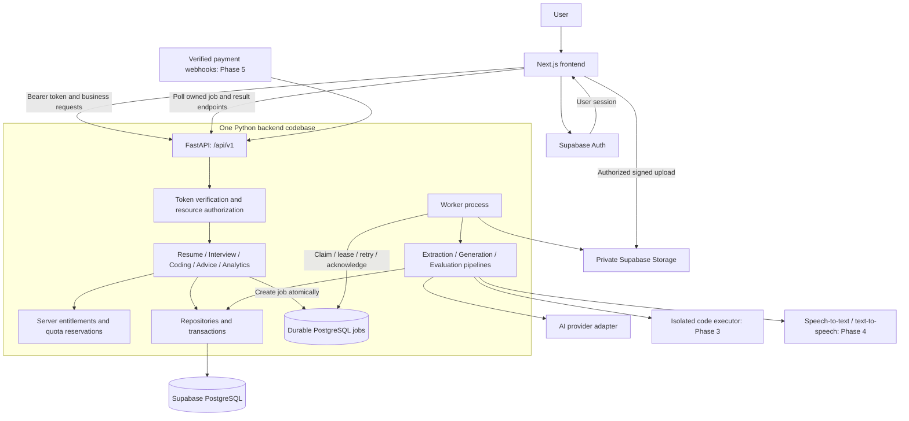

# Mockmate architecture: building with Codex

Target design and Phase 2 reference · 8 November 2026

This is the current proposed build plan, replacing the two-person ownership split in `mockmate-architecture-and-team-plan.md`. The technical foundation remains the same. This document specifies future work; the current application is still a frontend demo.

## Ownership and build approach

Codex implements the frontend, backend, database migrations, integrations, tests, and setup documentation in this repository. The project owner supplies provider accounts/credentials through local environment configuration, resolves product choices when necessary, and controls external purchases and production access. Secrets never belong in prompts, source files, or Git.

Build sequential vertical slices with integration checks at each boundary. Retain the existing frontend and URLs. Use one repository, one Next.js app, and one modular FastAPI backend. Run the API and durable worker as separate processes from the same backend codebase. Keep AI inside the backend; do not start with independently deployed AI microservices.

## Target architecture diagram



The jobs node is logically separate in the diagram but lives in the same PostgreSQL database initially. API and worker use server credentials; browsers receive only approved DTOs, publishable auth configuration, and short-lived authorized upload access. AI, executor, speech and payment adapters are server-side integrations.

## Repository layout

```text
Mockmate/
|-- src/                              Existing Next.js frontend
|   |-- app/                          Public pages, auth, workspace, interview room
|   |-- components/                   UI, shell, charts driven by real props
|   |-- features/                     Auth, resume, interview, coding, advice, settings
|   |-- services/                     Typed authenticated API calls
|   |-- lib/
|   |   |-- supabase/                 Browser/server auth clients
|   |   `-- api/generated.ts          Generated API DTOs
|   |-- stores/                       UI state and account-scoped unsent drafts
|   |-- hooks/                        Devices, polling, access display
|   |-- config/                       Public configuration and presentation
|   `-- demo/                         Explicit demo adapters, fixtures and state
|
|-- backend/
|   |-- app/
|   |   |-- main.py                   Application entry point
|   |   |-- core/                     Auth, config, DB, errors, logging, rate limits
|   |   |-- api/v1/                   Request validation and HTTP endpoints
|   |   |-- modules/                  Services, schemas and repositories by domain
|   |   |-- ai/                       Generation, evaluation, prompts and rubrics
|   |   |-- integrations/             AI, private storage, PDF, executor, speech
|   |   `-- workers/                  Durable jobs and task handlers
|   |-- tests/                        Unit, API/DB integration and AI evaluations
|   |-- pyproject.toml
|   |-- uv.lock
|   |-- .env.example                  Server variable names only
|   `-- Dockerfile                    Shared image; API/worker commands differ
|
|-- supabase/
|   |-- migrations/                   Single authoritative migration history
|   |-- tests/                        Ownership, RLS and private storage checks
|   |-- seed.sql                      Synthetic development data
|   `-- config.toml
|-- contracts/                        Exported OpenAPI and agreed examples
|-- tests/                            Demo and real API-backed browser suites
|-- scripts/                          Contract generation and checks
|-- docs/                             Architecture, milestones, setup and deployment
|-- infrastructure/deployment/        Selected hosting configuration/runbooks
|-- .github/workflows/                Frontend, backend, DB and integration CI
|-- compose.yaml                      Local API and worker orchestration
|-- .env.example                      Public frontend variable names
`-- package.json                      Existing frontend toolchain
```

No file moves or scaffolding are performed by creating this document. Add directories only when their implementation milestone starts. Use the earlier detailed tree as a module reference; its A/B/shared ownership labels no longer apply.

## Non-negotiable application boundaries

1. Supabase Auth owns identity. FastAPI verifies tokens and authorizes each resource, including nested answers, reports, jobs, submissions and file paths. Protected pages alone do not secure the API.
2. FastAPI owns business rules, quotas, entitlement checks, deadlines and state transitions. Local Storage and frontend plan controls cannot grant real access.
3. PostgreSQL owns durable application state. Zustand owns UI state and optional unsent drafts. Real results/history must work across devices. Clear or segregate drafts on account change.
4. Use `supabase/migrations/` as the only schema migration history. Enable policies for exposed database/storage resources. Explicitly test the backend connection's ownership behavior; direct server DB access does not inherit browser RLS identity automatically.
5. Pydantic schemas generate OpenAPI and TypeScript DTOs. CI checks generated contract drift. Runtime response validation is required at external/provider boundaries.
6. Long-running work uses durable jobs with atomic claims, leases, stale-job recovery, bounded retries and idempotent writes. A failed provider call must not become a fixed successful score.
7. AI outputs are validated and tied to real inputs, with prompt/model/rubric versions recorded. Test-derived coding correctness stays separate from AI feedback.
8. Execute submitted code only in an isolated, resource-limited executor. Hidden tests stay server-only. Browser integrity events remain advisory observations.
9. Real application views never silently fall back to demo fixtures. Demo mode remains explicitly labelled and isolated from real accounts.

## Phases and completion gates

### Phase 1 — Existing frontend demo

Already substantially implemented: responsive screens, demo workflows, local persistence, plan presentation, browser device preview and frontend tests. This does not establish real authentication, AI or storage.

### Phase 2 — Real accounts and core AI product

Implement in this order:

1. **Foundation:** FastAPI, environment validation, database migrations, verified auth, owned profiles, error conventions, generated contracts, local API/worker setup.
2. **Resume slice:** private upload -> server validation -> durable extraction/analysis job -> persisted input-derived result -> history, retries and deletion.
3. **Interview slice:** generated question snapshots -> server-owned active session -> saved answers -> immutable completion snapshot -> durable evaluation -> per-session saved report.
4. **Connected workspace:** real history, charts, analytics and suggestions derived from the saved results; server entitlements and atomic quota reservations; remove hardcoded live scores and fixture imports.
5. **Verification and handoff:** backend/DB/browser integration checks, negative ownership tests, provider timeout/failure tests, worker-restart recovery, setup documentation and CI.

Core records: profiles, entitlements, usage reservations, resumes, resume analyses, interview sessions, questions, answers, reports and jobs. Suggestions/analytics initially derive from those records.

Phase 2 is complete when two accounts have isolated data, a resume actually supplies its saved analysis input, an interview's own answers supply its evaluation, results survive another device, and provider/worker failures recover without fabricated success. Local checks should use deterministic provider adapters; a separately identified real-provider smoke test verifies actual configured AI access.

Coding remains explicitly demo-only until Phase 3. Voice/video controls must not imply implemented transcription, recording, or video analysis. Free/Pro screens use server capabilities; real paid checkout is deferred. The existing 3/20 browser-lifetime quotas are demo rules, not a settled production reset period. Record a production quota policy before enforcing it, and keep billing interval unpromised until decided.

### Phase 3 — Real coding interviews

Implement versioned problems, server timers, saved drafts, sample runs, immutable submissions, hidden tests, executor isolation, separate AI explanations and owned integrity logs. Add coding rounds, submissions, execution results and reports to the schema. Gate on actual correct/wrong-code, timeout/output-limit and cross-user-access tests. Keep test data hidden from all browser-readable results.

### Phase 4 — Voice interview experience

Add turn-based recording/transcription, transcript correction, normal answer submission and optional synthesized question playback. Define consent, audio limits, retention and supported formats. Gate on actual microphone -> transcript -> saved answer -> report, with device-denied and provider-failure handling. Existing local camera preview can remain. Realtime WebRTC, video recording/analysis and face detection need separate requirements before being added.

### Phase 5 — Billing and production release

Choose billing interval, quota window/reset, gateway, cancellation/refund rules and hosting. Implement verified, deduplicated webhooks and server-owned subscription lifecycle; test quota concurrency and entitlement changes. Deploy frontend, API and worker; run migrations; verify storage policies, logs, provider budgets, backups, retention/deletion and recovery procedures. Gate on a staging journey and the configured production smoke checks. Paid provider setup and credentials must be available before those integrations can be verified.

Job Matching and course Learning Hub remain outside the current four-area scope. These phases complete the current Mockmate product direction, rather than automatically restoring every module from the original InterviewIQ wish list.

## Phase 2 prompt reference

Use this document as the Phase 2 scope. Ask Codex to inspect the latest repository and applicable instructions, preserve the existing UI, implement the Phase 2 slices in order, and complete the corresponding integration checks. New source files, migrations and tests should accompany their actual implementation, not empty scaffolding.

Do not provision paid services, invent credentials, claim real provider verification from mocks, or move on with failing acceptance gates. If an external account/configuration is missing, implement and test the unaffected code and report the exact remaining setup step. Update this document and README to reflect what is actually real after each slice.

## Related references

- `docs/project-overview-and-architecture.md`: current implementation, not target design.
- `docs/mockmate-architecture-and-team-plan.md`: earlier detailed technical reference; ownership split superseded here.
- [FastAPI modular applications](https://fastapi.tiangolo.com/tutorial/bigger-applications/)
- [Supabase JWT guidance](https://supabase.com/docs/guides/auth/jwts)
- [Supabase storage access control](https://supabase.com/docs/guides/storage/security/access-control)
