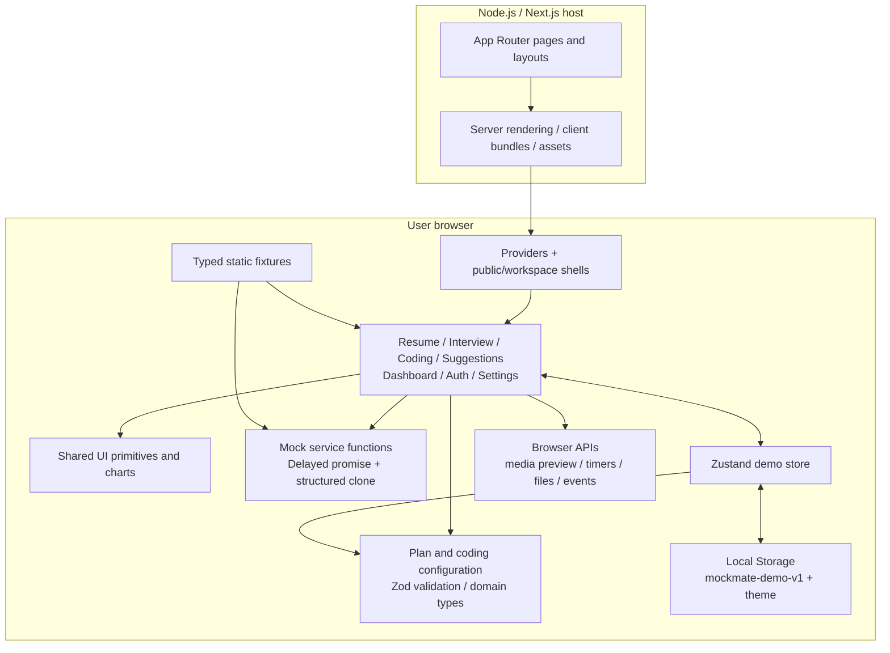
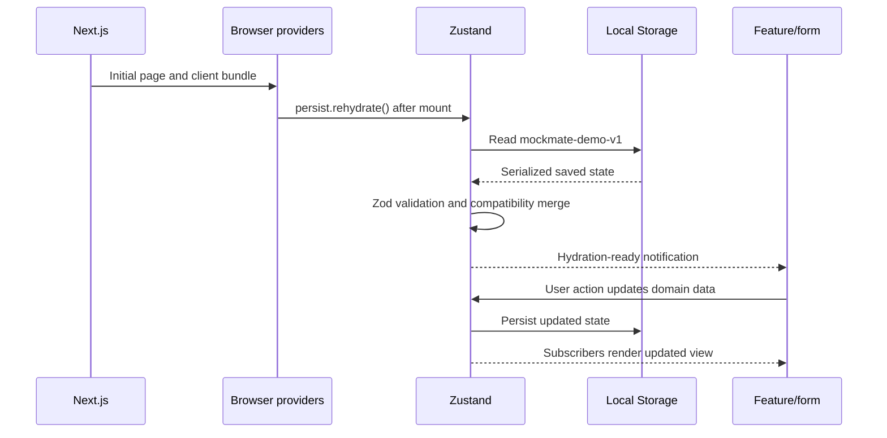

# Mockmate: complete project overview and current architecture

Prepared from the local source, package manifest, lockfile, configuration, and tests on **8 November 2026**. This describes the implementation currently in `A:\Mockmate`. Package versions below are resolved versions in `package-lock.json`, rather than estimates or latest upstream releases.

## 1. Project identity and implementation stage

Mockmate is a career-preparation web application with four main product domains:

1. Resume Analysis.
2. AI Interview Practice.
3. AI Coding Rounds.
4. Suggestions & Advice.

Dashboard, analytics, marketing, mock authentication, settings, and plan access support those domains. The package is named `mockmate`, version `0.1.0`, and marked private.

**The current implementation is a Phase 1 frontend demo.** It has real navigation, input validation, editing, timers, charts, local media previews, persistence, and downloadable demo outputs. Resume scores, interview responses, coding output, and evaluations come from predefined fixtures. There is no implemented application backend, database, real authentication provider, payment integration, AI inference, PDF parser, or code-execution engine.

The distinction matters: Next.js supplies a web server and server rendering, but the project does not implement a business API or trusted server-side identity and data layer. An `api-client.ts` filename does not mean HTTP requests are being made: its current implementation uses a delay followed by `structuredClone`.

## 2. Languages, formats, runtime, and build tools

### 2.1 Languages used to build the application

- **TypeScript (`.ts`)**: domain types, configuration, services, state store, hooks, fixtures, utility functions, and browser tests.
- **TypeScript with JSX (`.tsx`)**: React components, route pages, layouts, forms, and feature interfaces. JSX becomes JavaScript that produces the UI.
- **CSS (`.css`)**: semantic theme variables, responsive layouts, reusable styles, accessibility states, and animation rules, together with Tailwind utilities.
- **JavaScript ES modules (`.mjs`)**: ESLint and PostCSS configuration.
- **HTML**: rendered by React/Next.js from TSX; this is not a separate hand-written multi-page HTML application.
- **JSON**: npm manifest, dependency lockfile, TypeScript and component-generator configuration, and serialized local state.
- **SVG**: vector application icon and vector UI graphics, including score/chart rendering.
- **Markdown**: project documentation.

JavaScript, Python, Java, and C++ are offered as *practice-editor choices*. Python, Java, and C++ are stored starter-code strings, not backend languages or executable runtimes integrated into this project. No Python backend exists in this source tree.

### 2.2 Runtime and toolchain

- **Node.js** runs Next.js and development tools. README specifies Node 20.9 or newer and records Node 24 during implementation; this is a documented requirement, not an independently checked host version in this review.
- **npm** installs packages and runs scripts. `package-lock.json` records reproducible dependency resolution.
- **Next.js CLI** runs development, production builds, and the production server.
- **Webpack** is explicitly selected by `next dev --webpack` and `next build --webpack`. The frontend guide records a Windows PostCSS-worker problem with Turbopack as the reason for this choice.
- **PostCSS** runs the Tailwind CSS integration.
- **Git/GitHub**: this workspace currently has Git metadata and an `origin` remote pointing to `https://github.com/A-L-Chaitanya-Samir/Mockmate.git`. Older documentation describing an absence of Git metadata is historical. A configured remote alone does not establish deployment or the state of remote branches.
- **PowerShell** is the local command environment; it is not part of the application runtime.

There is no checked-in Docker setup, CI workflow, cloud deployment configuration, or production hosting integration visible in the inspected project files. The source does not identify every editor or external tool used historically, so those cannot be reconstructed reliably from the repository alone.

## 3. Complete direct library inventory

There are **18 application dependencies and 10 development dependencies**. Some supporting libraries are bundled into the application; others operate during development or compilation. The full transitive lockfile inventory is supplied separately in `dependency-inventory.md` and `dependency-inventory.json`.

### 3.1 Framework and rendering

- **`next` 16.4.5**: App Router, file-based routing, layouts, navigation, metadata, server/client component integration, build pipeline, and serving.
- **`react` 19.3.1**: component model, JSX rendering logic, state, effects, refs, and hydration-related hooks.
- **`react-dom` 19.3.1**: React's browser DOM rendering infrastructure, used through the framework and component ecosystem.

### 3.2 Forms and validation

- **`react-hook-form` 7.91.0**: authentication, interview setup, and profile forms; tracks field state, submission, and errors.
- **`zod` 4.6.7**: input schemas and validation of persisted domain records. TypeScript checks development-time types; Zod checks actual runtime data.
- **`@hookform/resolvers` 7.0.3**: connects Zod schemas to React Hook Form through `zodResolver`.

### 3.3 Shared state and persistence

- **`zustand` 5.1.0**: shared demo state and actions; its persist middleware serializes state into browser storage.

### 3.4 UI behavior and component composition

- **`@radix-ui/react-dialog` 1.3.1**: dialogs and the mobile navigation drawer, including modal focus behavior.
- **`@radix-ui/react-tabs` 1.2.1**: keyboard-accessible tabs.
- **`@radix-ui/react-tooltip` 1.4.1**: tooltips and the shared tooltip provider.
- **`@radix-ui/react-slot` 1.5.0**: the button `asChild` composition pattern, allowing a link to retain its semantics while receiving button styling.
- **`class-variance-authority` 0.7.1**: typed button variant/size class definitions through `cva`.
- **`clsx` 2.1.1**: conditional CSS class construction.
- **`tailwind-merge` 3.7.0**: resolves conflicting Tailwind classes; combined with `clsx` in `cn()`.
- **`lucide-react` 1.70.0**: interface and navigation icons.

The project follows **shadcn-style, copy-and-own components**. Its UI source lives in `src/components/ui`; there is no installed monolithic `shadcn/ui` runtime package. `components.json` describes the New York style, slate base, CSS variables, aliases, React Server Components, and Lucide icon choice.

### 3.5 Charts, appearance, and feedback

- **`recharts` 3.10.1**: area, radar, and horizontal bar charts.
- **`next-themes` 0.4.6**: dark/light/system appearance with class-based theming.
- **`sonner` 2.0.8**: toast notifications for success, validation, storage fallback, and integrity events.

### 3.6 Development dependencies

- **`typescript` 6.0.3**: static checking with strict mode and `tsc --noEmit`.
- **`@types/node` 26.6.6**: Node.js type declarations; this package version is not the installed Node runtime version.
- **`@types/react` 19.3.0** and **`@types/react-dom` 19.3.0**: React/DOM TypeScript declarations.
- **`tailwindcss` 4.3.5**: utility CSS and theme integration.
- **`@tailwindcss/postcss` 4.3.5**: Tailwind's PostCSS plugin.
- **`eslint` 9.39.5**: static linting.
- **`eslint-config-next` 16.4.5**: Next.js Core Web Vitals and TypeScript lint presets.
- **`prettier` 3.9.10**: available formatter; no dedicated formatting script is defined in `package.json`.
- **`@playwright/test` 1.65.0**: automated browser tests, assertions, traces, screenshots, and HTML test reports.

## 4. Product domains and their components

### 4.1 Marketing and public pages

**Purpose:** explain Mockmate, present its capabilities and plans, and provide entry points into the demo.

**Components:** `Home`, `PricingCards`, and `PricingComparison`, with `MarketingShell`, `Brand`, and `ThemeToggle` supplying shared presentation. The About page is implemented in its route file.

**Routes:** `/`, `/about`, `/pricing`.

Pricing reads the same central plan configuration used by access checks. Static marketing content and route wrappers can remain server-rendered; interactive upgrade/theme controls use client components.

### 4.2 Demo account and authentication interface

**Component:** `AuthForm`, parameterized with `login`, `register`, or `forgot` mode.

**Routes:** `/login`, `/register`, `/forgot-password`.

React Hook Form and Zod validate email format, an eight-character demo password for login/registration, a registration name, and acknowledgement. `authService.signIn()` returns a predefined profile; registration can substitute the entered display name. The store records a demo `authenticated` flag and profile. Email and password do not enter persisted state. Recovery returns a demo confirmation without sending email.

Dashboard URLs deliberately remain accessible for portfolio exploration. There is no identity verification, token/session issuance, OAuth flow, password hashing, or server authorization boundary.

### 4.3 Dashboard, history, and analytics

**Components:** `Overview`, `Analytics`, and `InterviewHistory`.

**Routes:** `/dashboard`, `/dashboard/analytics`.

The overview reads profile, history, resumes, coding rounds, and plan capabilities. It shows metrics, recent activity, actions, and suggestions. `InterviewHistory` renders reusable session history and report links. `Analytics` supports all sessions versus the latest three, calculating averages from local history.

`PerformanceChart` plots history scores, `CompetencyChart` displays fixture skill scores on a radar chart, and `SkillChart` displays fixture scores as bars. Calculated history averages are real calculations over demo data; the underlying scores remain simulated. Seed history also contributes to these views. Analytics is supporting interview functionality, rather than a separate core product domain.

### 4.4 Resume analysis and improvement

**Components:** `ResumeWorkspace`, internal `ResumeResults`, `ResumeImprove`, and internal `ResumeImproveForm`.

**Routes:** `/dashboard/resume`, `/dashboard/resume/analyze`, `/dashboard/resume/improve`.

The workspace accepts local file selection or drag/drop. It validates a PDF MIME type and filename extension, rejects empty files, and enforces a 5 MiB limit. Browser object URLs provide a temporary local preview. The component revokes URLs when replaced or unmounted.

`resumeService.analyze()` accepts no document content and returns a predefined `ResumeAnalysis` after simulated latency. The store saves filename, size, date, ID, and the sample analysis. The UI shows a sample score, skill indicators, strengths, improvements, and prior local records. It does not read PDF text, perform ATS scoring, or upload a file.

Free provides basic feedback. Pro unlocks the guided advanced improvement interface. Its input must contain at least 20 characters; the output is a fixed example, not a rewrite generated from the input. Notes can be downloaded as a text file. Improvement text stays in component memory rather than persisted state.

### 4.5 Interview practice

**Components:** `InterviewList`, `InterviewSetup`, internal `SetupForm`, `InterviewRoom`, internal `ActiveRoom` and `SparkTip`, and `InterviewReport`.

**Routes:** `/dashboard/interview`, `/dashboard/interview/setup`, `/interview-room/[interviewId]`, `/dashboard/interview/[interviewId]/report`.

Setup collects interview type (Technical, HR, Behavioral, Mixed), role, difficulty, language, duration, and mode (Text, Voice, Video). Supported durations are 10, 15, 20, 30, and 45 minutes. `configSchema` validates the configuration.

`interviewService.create()` produces a `demo-` UUID session. The store enforces the created-session quota, saves the session, and the router opens its room. Question selection depends on the interview type; other settings are saved as context without generating personalized questions.

The room persists typed answers, tracks the current question, and shows scripted acknowledgements. Proceeding requires at least 10 non-whitespace characters. Its timer counts while the room is mounted, saves every five seconds and on unmount, and pauses while the user is away from the room. At zero, the UI asks the user to wrap up rather than automatically discarding the answer.

`useDevices` uses browser camera/microphone permissions after a user action. The camera supplies a local preview; microphone state reflects local device access. The system does not record, transcribe, upload, or send these streams to an AI. Tracks stop on disable, interview completion, and unmount; late-resolving requests are also cleaned up.

Ending awaits a fixture evaluation, marks the session completed, adds a history summary, and opens the report. Newly completed sessions receive the fixed demo score of 87 in history. Reports combine sample scores/guidance with saved answers and can export a labeled JSON demo report. Detailed feedback depends on plan access. A generated session is browser-local; its URL alone cannot recover the session on another device. Seed sample reports are available from fixtures.

### 4.6 Coding rounds

**Components:** `CodingWorkspace`, internal `CodingContent`, `CodingSetup`, `CodingRound`, `RoundEditor`, and `IntegrityPanel`.

**Route:** `/dashboard/coding`, gated by the `codingRounds` capability.

The fixture catalog contains **Two Sum** and **Balanced Brackets**. Users select a problem and JavaScript, Python, Java, or C++. `codingService.create()` creates a round with a UUID, starting timestamp, per-language starter drafts, status, empty follow-up answers, and integrity counters. The workspace opens its latest stored round or setup screen.

The editor is a native controlled **textarea**, not Monaco or CodeMirror. It provides plain text editing, language-specific drafts, selection, undo, deletion, and a 30,000-character maximum. Tab moves focus; spaces provide indentation. Follow-up answers are capped at 2,000 characters.

Run returns an explicit simulated-output message. Test cases are fixed expected examples, not results of executing a submission. Submit checks for at least a minimally changed solution/pseudocode and returns a fixture `CodingEvaluation`; it does not compile, execute, or determine correctness. Round status can be `active`, `submitted`, or `ended`.

The coding timer is 30 minutes by default and derives remaining time from `startedAt`. Unlike the interview timer, time away continues to count. This is still a browser-controlled clock, not a trusted assessment timer.

### 4.7 Coding integrity behavior

**Files:** `use-coding-integrity.ts`, `round-editor.tsx`, `coding-round.tsx`, `integrity-panel.tsx`, and `config/coding.ts`.

Active rounds intercept ordinary copy/cut and context-menu actions in the environment; editor paste and drop paths are blocked. Visibility changes and window focus loss are observed through browser events. A short blur delay reduces duplicate logging for a single tab switch.

Events contain an ID, type, detail, and timestamp. The store retains the latest 200 events and a separate total event count. The review threshold is three events. The panel gives neutral information and warnings; events do not automatically accuse the user or reduce a score.

These are transparent UI deterrents. They are not secure proctoring: local state and browser handlers can be changed, clocks are client-controlled, and screenshots or external devices are outside their reliable control.

### 4.8 Suggestions and advice

**Component:** `Suggestions`. **Selection function:** `buildSuggestions()` in `suggestions-data.ts`.

**Route:** `/dashboard/suggestions`.

Advice categories are Resume, Interviews, Communication, Technical, and Coding. The function reads the latest resume analysis, interview history, and coding evaluation, using sample fallbacks when needed. Coding advice appears for permitted Pro access. Items include source descriptions and links to relevant actions. Category filters organize the view.

This is deterministic composition of predefined content and local context, with no recommendation model or AI request. The dashboard reuses the same function.

### 4.9 Settings and plans

**Components:** `Settings`, internal `ProfileForm` and `SettingsContent`, and `PlanSettings`.

**Route:** `/dashboard/settings`.

Settings edits a validated display profile, interview defaults, notification/reminder preferences, theme, local plan, and demo reset. Stored notification/reminder toggles do not constitute an implemented email, push, or reminder delivery service.

`src/config/plans.ts` defines exactly two plans: **Free, ₹0**, and **Mockmate Pro, ₹299**. No billing interval is specified. The quotas are three and twenty created interview sessions, respectively; they are browser-local lifetime counts, not monthly allowances. Unfinished created sessions count; seed history does not.

Capabilities are `codingRounds`, `advancedResume`, and `detailedFeedback`. `useFeatureAccess` centralizes UI checks. `FeatureGate` renders permitted content or an upgrade prompt after hydration. `beginInterview` also checks quota at the store boundary; coding saves check current plan access. These checks support consistent demo behavior but cannot enforce a paid subscription securely.

`UpgradeButton` opens a clear local-demo dialog and changes the stored plan to Pro. `UpgradePrompt` supplies locked-feature messaging; `InterviewLimitNotice` explains quota exhaustion. No payment information is collected and no subscription is created.

## 5. Shared component system

### 5.1 Application composition

- **`RootLayout`**: HTML language, shared metadata/title template, global CSS, skip link, and root providers.
- **`Providers`**: next-themes, Radix tooltip context, Sonner toaster, and post-mount Zustand rehydration.
- **`AppShell`**: workspace header, breadcrumb, profile shortcut, desktop sidebar, mobile drawer, footer, and optional focused room styling.
- **`SidebarContent`**: shared desktop/mobile navigation, active-route styling, profile/plan context, and logout action.
- **`MarketingShell`**: public navigation, content frame, and footer.
- **`Brand`** and **`ThemeToggle`**: product identity and appearance controls.

Six primary sidebar destinations come from `constants/navigation.ts`: Dashboard, Resume Analysis, AI Interviews, Coding Rounds, Suggestions & Advice, and Settings.

### 5.2 UI primitives

- **`Button`**: shared button variants, sizes, disabled behavior, and `asChild` composition.
- **`Dialog`**, **`Tabs`**, **`Tooltip`**: owned wrappers around Radix behavior.
- **`Panel`**: reusable content surface.
- **`Badge`**: compact status/category label.
- **`DemoNotice`**: simulation disclosure.
- **`PageHeading`**: title, description, eyebrow, and page action composition.
- **`ScoreRing`**: circular score display.
- **`Progress`**: labeled progress indicator.
- **`Metric`**: numeric summary with supporting context.
- **`CheckList`**: reusable list of benefits or feedback.
- **`Field`**: labels, hints, and error presentation around inputs.
- **`EmptyState`**: missing content with a recovery action.
- **`Spinner`** and **`Skeleton`**: loading feedback.

### 5.3 Design and accessibility

`globals.css` defines shared background, surface, text, border, primary, status, spacing, radius, and layout roles. Light and dark themes reuse the same semantic variables. Tailwind utilities compose layouts around these styles.

Desktop navigation can collapse; mobile uses a modal drawer with Escape and focus handling. The interview layout moves its performance panel below the conversation at narrower widths. Tables scroll within their containers; charts use explicit heights and responsive containers. The implementation includes input labels, icon action names, a skip link, visible focus behavior, accessible dialog/tab behavior, and reduced-motion rules. These are source-level provisions, not a claim of a formal accessibility audit.

## 6. Current architectural design

### 6.1 Overall structure

The application uses a **modular frontend with feature folders and layered supporting code**. It is one Next.js application, not a distributed set of services.



The host serves the application. Current feature operations run in browser-side client components. Static route/marketing composition can run on the server. The mock-service arrows represent function calls, not network connections. Some views read fixtures directly, so this is a practical separation rather than a strict architecture in which every read must pass through a service.

### 6.2 Layer responsibilities

1. **Routing (`src/app`)** chooses the screen and layout, handles dynamic parameters, and supplies loading/error/not-found boundaries.
2. **Feature layer (`src/features`)** coordinates user actions, feature state, services, and store updates.
3. **Presentation layer (`src/components`)** implements reusable UI, navigation, charts, and access prompts.
4. **Service layer (`src/services`)** exposes promise-based operations for authentication, resumes, interviews, and coding.
5. **State/persistence (`src/stores`, `src/lib/demo-storage.ts`)** shares browser-local records across routes and reloads.
6. **Domain/support (`src/types`, `src/config`, `src/data`, `src/lib`, `src/hooks`)** provides contracts, policies, fixtures, validation, lifecycle handling, and helpers.

### 6.3 State architecture

Three state scopes are used deliberately:

- **React state**: open dialogs, busy states, filters, preview URLs, current temporary editor/improvement UI state.
- **React Hook Form**: validated form values, errors, dirty/submission state, and initial defaults.
- **Zustand**: demo authentication flag, profile/preferences, selected plan, interview sessions/history, resume records, and coding rounds.

The store's main actions are `login`, `logout`, `saveProfile`, `savePreferences`, `setPlan`, `beginInterview`, `saveSession`, `addResume`, `saveCodingRound`, `recordIntegrityEvent`, and `reset`.

### 6.4 Persistence and hydration



Persistence has version `1`, uses `skipHydration: true`, and begins explicitly in `Providers`. `useDemoReady` waits for persistence completion before mounting forms that need saved defaults. `useHydrated` distinguishes browser rendering for browser-dependent elements such as charts. This reduces hydration mismatches and incorrect initial form defaults.

Zod validates saved records before merging. Missing/invalid plan data defaults to Free, missing coding rounds initialize safely, and retired learning-progress fields are stripped. Invalid saves fall back to defaults. `demoStorage` catches unavailable/corrupt/full storage and supports an in-memory fallback, with a warning when writes cannot persist.

The key `mockmate-demo-v1` contains text practice data, profile/preferences, local plan, resume metadata and sample analyses, coding drafts, follow-up answers, and integrity events. `next-themes` separately uses the `theme` key. PDF bytes, media streams, email, passwords, payment details, and resume-improvement drafts are not persisted. Logout clears simulated login while preserving practice data; reset restores the initial Free workspace and seed history.

### 6.5 Main domain contracts

- **`Profile`**: name, role, bio.
- **`Preferences`**: notification/reminder toggles and default interview type/mode.
- **`InterviewConfig`**: type, role, difficulty, language, duration, mode.
- **`Question` / `Answer`**: predefined prompt/guidance and typed answer linked by question ID.
- **`InterviewSession`**: ID, configuration, timestamp, answers, current index, elapsed seconds, status.
- **`InterviewSummary`**: history row with role/type/date/score/duration.
- **`InterviewReport`**: overall score, skill scores, strengths, improvements, topics.
- **`ResumeAnalysis` / `ResumeRecord`**: sample analysis plus selected-file metadata.
- **`CodingProblem`**: statement, constraints, examples, language starters, and follow-up prompts.
- **`CodingRound`**: selected problem/language, timestamps, drafts, status, events/count, follow-up answers, optional evaluation.
- **`CodingEvaluation`**: feedback dimensions, suggestions, disclosure.
- **`IntegrityEvent`**: ID, event type, detail, timestamp.
- **`Suggestion`**: category, title, explanation, source, action URL, and action label.

These are frontend TypeScript contracts with selected Zod runtime equivalents, not database tables or deployed HTTP endpoints.

## 7. Route and directory reference

### 7.1 Route map: 18 page definitions

Public routes: `/`, `/about`, `/pricing`, `/login`, `/register`, `/forgot-password`.

Workspace routes: `/dashboard`, `/dashboard/analytics`, `/dashboard/coding`, `/dashboard/interview`, `/dashboard/interview/setup`, `/dashboard/interview/[interviewId]/report`, `/dashboard/resume`, `/dashboard/resume/analyze`, `/dashboard/resume/improve`, `/dashboard/settings`, `/dashboard/suggestions`.

Focused dynamic route: `/interview-room/[interviewId]`.

Parenthesized `(public)` and `(workspace)` folders organize layout groups without appearing in URLs. Bracketed segments accept dynamic IDs. Route wrappers await framework parameters before passing plain values into feature components.

`dashboard/loading.tsx` supplies loading UI, `app/error.tsx` supplies retry behavior, and `app/not-found.tsx` supplies the unknown-route fallback. Feature-specific empty states handle unknown local sessions. Learning Hub and standalone Job Matching have been removed from the current product and routes.

### 7.2 Directory responsibilities

```text
src/app/          Route pages, layouts, global CSS, metadata, fallbacks
src/features/     Product domains and supporting page behavior
src/components/   Shared shells, navigation, chart and access components
src/components/ui/ Owned UI primitives
src/config/       Plan capabilities and coding limits/settings
src/constants/    Navigation configuration
src/data/         Interview/resume/report/history and coding fixtures
src/hooks/        Hydration, feature access, devices, integrity lifecycles
src/lib/          Validation, formatting/class helpers, storage adapter
src/services/     Mock transport and promise-based feature operations
src/stores/       Zustand domain state and persistence
src/types/        Shared interview/resume/profile and coding contracts
tests/            Playwright browser tests
docs/             Guides, QA screenshots, design references, this report
```

## 8. Configuration and development workflow

### 8.1 Important configuration files

- `package.json`: scripts and direct dependencies.
- `package-lock.json`: resolved dependency tree; includes platform-specific optional packages.
- `tsconfig.json`: strict checking, ES2020 target, modern DOM/ES libraries, bundler module resolution, React JSX, Next plugin, and `@/*` alias to `src/*`.
- `next.config.ts`: disables the `X-Powered-By` header; no backend integrations configured.
- `postcss.config.mjs`: Tailwind PostCSS plugin.
- `eslint.config.mjs`: flat config using Next Core Web Vitals and TypeScript rules; excludes generated output.
- `components.json`: shadcn-style component generation conventions.
- `playwright.config.ts`: browser suite settings and dedicated production-server lifecycle.
- `.gitignore`: ignores node_modules, build/test output, TypeScript build metadata, and environment files except an optional example.

### 8.2 Commands

```powershell
npm.cmd ci                 # Install the locked dependency graph
npm.cmd run dev            # Next.js development server with Webpack
npm.cmd run typecheck      # TypeScript check, no emitted files
npm.cmd run lint           # ESLint; warnings cause failure
npm.cmd run build          # Production Webpack build
npm.cmd start              # Serve the production build
npm.cmd run test:e2e       # Playwright suite; production build needed first
```

The ordinary development URL is `http://localhost:3000`. Playwright normally starts a separate production server on port `3100`. `PLAYWRIGHT_BASE_URL` explicitly overrides the server target; `PLAYWRIGHT_CHANNEL` can choose installed Chrome. The test configuration includes fake camera/microphone flags for reproducible media checks.

### 8.3 Test coverage and verification provenance

There are **18 current Playwright test definitions** across three files:

- `frontend.spec.ts`: route/link health, registration/login/recovery validation, credential non-persistence, interview flow, media cleanup, resume flow, settings, mobile navigation, unknown sessions, and malformed stored data.
- `product-focus.spec.ts`: two-plan configuration, capability gates, plan persistence, coding edits/follow-ups/submission, clipboard/integrity behavior, suggestions, quotas, legacy-save compatibility, and responsive coding layouts.
- `visual.spec.ts`: responsive interview composition and keyboard drawer behavior, with screenshot captures.

The configuration uses one Chromium project/worker, 45-second test timeout, retained failure traces/screenshots, and an HTML reporter. Visual captures are evidence of layout checks; their presence does not by itself imply a full pixel-diff regression suite.

`docs/product-scope-refinement.md` records successful typecheck, lint, production build, and 18 browser tests on 8 November 2026. The older checklist records 13 tests and mentions removed job/learning functionality. Those are historical results. **This review inspected source and configuration; it did not rerun builds, tests, or a dependency security audit.** Older audit numbers should not be read as a fresh security result.

## 9. Current boundaries and future architecture

### 9.1 Implemented today

Working frontend flows, typed contracts, runtime input validation, responsive shared UI, local state and persistence, camera preview/device cleanup, timers, editing, sample analysis/reporting, local feature gates, and browser tests.

### 9.2 Required for a production service

- A backend API with request validation and trusted authorization.
- Real identity/session management and server-side feature/usage enforcement.
- A database for durable multi-device history, profiles, and assessment records.
- Authenticated file upload/storage and actual resume text extraction.
- Server-side AI integration, output validation, request limits, and private credential handling.
- An isolated, resource-limited execution environment for coding submissions.
- Real subscription/billing rules, payment integration, and trusted subscription status.
- Recording/transcription infrastructure if voice/video assessment is intended.
- Trusted event ingestion if coding integrity logs are used for review.
- Defined deployment, monitoring, retention, backup, and recovery behavior.

The existing guide proposes **FastAPI, PostgreSQL, Supabase Auth, and server-side OpenAI integration** for a later phase. They are planning directions, not libraries or services already integrated. The promise-based service boundary gives a useful migration seam, but production work also requires authenticated IDs, response schemas, cancellation/errors, database persistence, and server permission checks; replacing a few mocked functions alone would not complete that transition.

## 10. Source guide

For the shortest path through the system, read these files in order:

1. `src/app/layout.tsx` and `src/components/providers.tsx`: application startup and hydration.
2. `src/components/app-shell.tsx` and `src/constants/navigation.ts`: workspace composition.
3. `src/config/plans.ts` and `src/hooks/use-feature-access.ts`: product access rules.
4. `src/features/interview/interview-setup.tsx`: a form-to-service-to-store workflow.
5. `src/services/mock-services.ts` and `src/services/api-client.ts`: simulated operation boundaries.
6. `src/stores/demo-store.ts` and `src/lib/demo-storage.ts`: domain updates and persistence.
7. `src/features/interview/interview-room.tsx`: active workflow, timer, answers, and completion.
8. `src/features/coding/coding-round.tsx` and `src/hooks/use-coding-integrity.ts`: coding lifecycle and browser-event handling.
9. `src/types/index.ts`, `src/types/coding.ts`, and `src/lib/validation.ts`: contracts and runtime validation.
10. `tests/`: expected user-visible behavior.
